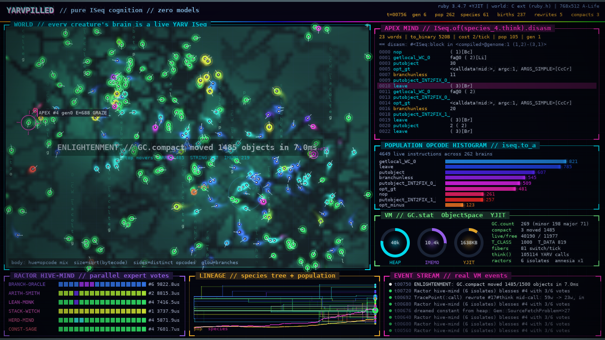
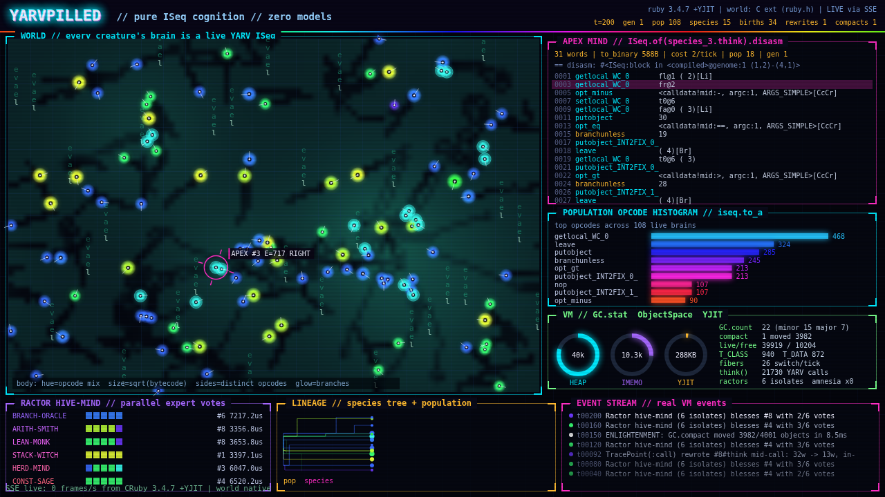
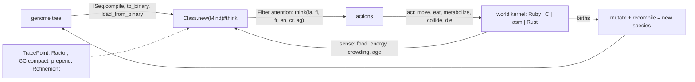

<div align="center">

# YARVPILLED

**An A-Life world where every creature's brain is a live YARV instruction sequence.**
Zero models. Pure CRuby. World loop in Ruby, C, Rust or hand-written x86-64 asm, all bit-identical.

[](https://github.com/0thernes/yarvpilled/actions/workflows/ci.yml)
[](https://github.com/0thernes/yarvpilled/releases)
[](LICENSE)
[](https://www.ruby-lang.org/)
[](https://docs.ruby-lang.org/en/master/yjit/yjit_md.html)
[](docs/adr/0003-stdlib-only.md)
[](https://0thernes.github.io/yarvpilled/)

**[Watch it in your browser](https://0thernes.github.io/yarvpilled/)**: a replay of a real CRuby run, recorded by CI.


</div>

Creatures move, eat, reproduce and die in real time. Each one thinks by executing a
`RubyVM::InstructionSequence` compiled from its genome. The genome's bytecode mutates when a
creature reproduces, natural selection hot-swaps live methods through `TracePoint`, and each
creature's body (color, size, shape, glow) is computed from its own opcode histogram.

| GC.compact "enlightenment" | TracePoint rewrite mid-call | terminal mode |
|---|---|---|
|  |  |  |
| **browser mode (SSE + canvas)** | **the living world** | **end of a 40 s run** |
|  |  |  |

## Contents

[Results](#results-at-a-glance) · [Quickstart](#quickstart) · [Usage](#usage) ·
[Architecture](#architecture) · [Real vs. metaphor](#whats-genuinely-real-vs-metaphor) ·
[Benchmarks](#benchmarks-ruby-vs-yjit-vs-c-vs-rust-vs-asm) · [Control experiment](#control-selection-vs-random-drift) ·
[Limitations](#limitations) · [Docs](#documentation) · [Citation](#citation) · [License](#license)

## Results at a glance

Speed, as median of 5 fresh processes (seed 11, 2000 ticks, identical checksum in all 30 runs):

| tier | creatures/sec | vs pure Ruby | world loop only (updates/sec) | share of tick in YARV brains |
|---|---:|---:|---:|---:|
| pure Ruby interpreter | 79,543 | 1.00x | 145,500 | 17% |
| pure Ruby + YJIT | 147,949 | 1.86x | 357,931 | 31% |
| C + YJIT | 278,971 | 3.51x | 3,202,418 | 72% |
| Rust + YJIT | 270,977 | 3.41x | 2,706,854 | 70% |
| hand-written asm + YJIT | 275,521 | 3.46x | 2,884,147 | 72% |

Evolution, from 8 seeds per arm, measured against a random-drift null model:

| metric | selection | drift | Holm-adjusted p |
|---|---:|---:|---:|
| foraging fitness (common-garden assay) | 5.009 | 4.417 | 0.038 |
| survival in assay | 0.708 | 0.512 | 0.009 |
| mean bytecode length (words) | 32.5 | 54.2 | 0.0009 |

**Verdict.** C, Rust and hand-written asm land within run-to-run noise of each other (about
3.5x pure Ruby end to end, about 20x on the world loop). Once the world is native, about 70% of
each tick is YARV running genome bytecode, so the brains set the speed, not the language of the
world loop. Selection measurably beats drift.

## Quickstart

Requirements: **CRuby 3.3+** (3.4 with YJIT recommended). Optional: a C compiler for the
native world (falls back to pure Ruby without one), **cargo** for the Rust backend, and
**ffmpeg** for `--video`. There are no gems to install.

### Linux

```sh
sudo apt install ruby-full build-essential ffmpeg       # or your distro's equivalents / a Ruby manager
curl https://sh.rustup.rs -sSf | sh                     # optional: Rust backend
git clone https://github.com/0thernes/yarvpilled && cd yarvpilled
rake compile && rake test
ruby --yjit yarv_brain.rb --tui
```

### macOS

```sh
xcode-select --install                                  # clang + make
brew install ruby ffmpeg rust                           # Homebrew Ruby (3.4) is YJIT-enabled
git clone https://github.com/0thernes/yarvpilled && cd yarvpilled
rake compile && rake test                               # :asm is x86-64 Linux only; on arm64 it uses the C scan
ruby --yjit yarv_brain.rb --tui
```

### As a gem (from a clone; not on RubyGems yet)

```sh
rake gem && gem install pkg/yarvpilled-*.gem    # compiles the C ext on install (Rust backend is repo-only)
yarvpilled --tui                                # same CLI as yarv_brain.rb; output goes to ./out
```

### Windows (RubyInstaller + DevKit)

```powershell
winget install RubyInstallerTeam.RubyWithDevKit.3.4     # or download "Ruby+Devkit 3.4" from rubyinstaller.org
ridk install                                            # choose option 3 (MSYS2 + MINGW toolchain)
git clone https://github.com/0thernes/yarvpilled; cd yarvpilled
rake compile                                            # builds the C world via DevKit, or falls back to pure Ruby
rake test
ruby yarv_brain.rb --tui                                # use Windows Terminal for truecolor
```

On Windows, `rake compile` enables the DevKit toolchain itself and skips the Rust and asm
backends. If the C build fails for any reason, it prints a warning and everything runs on the
bit-identical pure-Ruby world. You can force that path anywhere with `YARVPILLED_PURE=1`.
`ruby yarv_brain.rb --version` shows which backends are available.

## Usage

```sh
ruby --yjit yarv_brain.rb --tui           # live ANSI truecolor terminal (Ctrl-C to quit)
ruby --yjit server.rb                     # live browser: http://localhost:4567/  (SSE at /events)
ruby --yjit yarv_brain.rb --video         # out/yarvpilled.mp4 + .gif + still_*.png + run_log.txt
ruby --yjit yarv_brain.rb --headless      # simulate, print the event log + stats
ruby yarv_brain.rb --bench                # benchmark every available tier -> out/bench.md
ruby --yjit yarv_brain.rb --control       # selection vs drift experiment -> out/control.md
ruby yarv_brain.rb --version              # version + available world backends
```

Options: `--world=native|c|asm|rust|ruby`, `--seed=N`, `--ticks=N`, `--seconds=N`, `--fps=N`,
`--ticks-per-frame=N`, `--frames=N` (TUI), `--repeats=N` (bench), `--replicates=N` (control),
`--out=DIR`. Server: `--port=N --bind=ADDR --tps=N --world=KIND`. It binds to 127.0.0.1 by default.

### Rake tasks

| task | what it does |
|---|---|
| `rake compile` | Builds the ruby.h C extension, plus x86-64 asm on Linux/BSD and the Rust kernel if cargo is present. Falls back to pure Ruby on failure (`YP_STRICT=1` makes failure fatal; `YP_NO_RUST=1` skips Rust). |
| `rake test` | Runs the minitest suite. Native-only tests are skipped when the extension is absent. |
| `rake smoke` | Prints `--version`, then does a 300-tick headless run. |
| `rake bench` | Multi-tier benchmark (`REPEATS=5 TICKS=2000`), written to `out/bench.md` and `.json`. |
| `rake control` | Selection vs drift (`REPLICATES=8 TICKS=4000`), written to `out/control.md` and `.json`. |
| `rake video` | Renders the MP4, GIF, stills and run log (needs ffmpeg). |
| `rake site` | Builds the GitHub Pages demo into `_site/` (a 900-tick replay of a real run). |
| `rake gem` | Builds `pkg/yarvpilled-VERSION.gem`. |
| `rake labels` | Syncs the issue labels with `gh` (`DRY=1` prints the commands). |
| `rake clean` | Removes `tmp/`, `_site/`, `pkg/`, the compiled extension and the Rust `target/`. |
| `rake` | Runs `compile`, then `test`. |

Prefer [`just`](https://github.com/casey/just)? `just --list` shows the same recipes (it works on Windows too).

The video renderer outpaces real time on a modern CPU: 1260 frames of 1280x720 (42 s at 30 fps)
render in about 34 s while the simulation runs. So the MP4 is a recording of a live run, not an
offline composite.

## Architecture



**Division of labor.** The world kernels (Ruby / C / Rust / asm) only move bodies: spatial
hash grid, resource regrowth, movement, eating, metabolism, collision, death and corpse
nutrients. They never decide anything. Decisions always come from YARV running genome ISeqs.
All four backends use the same integer and IEEE-754 operation order (no FMA), and
`test/test_world_equivalence.rb` asserts they stay bit-identical over 300 ticks with births.
Details: [docs/architecture.md](docs/architecture.md) and the [ADRs](docs/adr/README.md).

## What's genuinely real vs. metaphor

| On screen | What actually happens in the VM |
|---|---|
| **Creature brain** | A Ruby lambda generated from a genome tree: `RubyVM::InstructionSequence.compile` → `#to_binary` → `.load_from_binary(...).eval` → `define_method(:think, &brain)` on a per-species `Class.new(Mind)`. Every tick, every creature calls `think(fa, fl, fr, en, cr, ag)` and YARV executes that block ISeq. **Real.** |
| **Mutation / reproduction** | When a child is born (30% chance), the genome tree is mutated (point, subtree, insert/delete statement, operator swap), re-rendered, and recompiled into a new species. **Real.** |
| **Body / phenotype** | Hue = CRC of the exact opcode multiset from `iseq.to_a`. Radius = √bytecode length. Polygon sides = distinct opcode count. Glow = branch count. Metabolic cost per tick = `1 + bytecode_len/22`, so bloated brains starve. **Real.** |
| **Natural selection rewrites live methods** | Every 150 ticks a targeted `TracePoint.new(:call).enable(target: weakest#think)` is armed. When YARV next enters that method, the hook fires *inside the call* (`caller_locations` shows `genome:2:block in <compiled>`) and `define_method`s a mutated copy of the apex genome. The in-flight call finishes on the old bytecode and the next call runs the new one. Both return values and the before/after disasm are logged in `run_log.txt`. **Real.** |
| **Apex disasm panel** | `RubyVM::InstructionSequence.of(apex.mind.class.instance_method(:think)).disasm`, i.e. the live method. **Real.** (The scrolling highlight bar is decoration, not a program counter.) |
| **Opcode rain** | Opcode names sampled from genomes compiled moments ago. **Real data, decorative motion.** |
| **Opcode histogram** | Sum of every living creature's `iseq.to_a` instructions. **Real.** |
| **Ractor hive-mind** | 6 `Ractor`s receive a `Ractor.make_shareable` table of candidate species and vote in parallel by their own taste (branch share, arithmetic share, leanness, ...). The winner's members get +90 energy. Latencies are measured inside each Ractor. **Real**; "expert" is the metaphor. |
| **Fiber attention** | Each tick, one `Fiber` per species runs its creatures' `think` calls, yielding every 8 creatures to a round-robin scheduler. The panel shows the switch count. **Real**, but it's cooperative scheduling, not attention math. |
| **GC.compact "enlightenment"** | `GC.compact` every 300 ticks. The flash shows `GC.latest_compact_info` (objects moved/considered, top types). **Real.** No zero-latency claims. |
| **GC "amnesia"** | Extinct species drop their only references to class, lambda and ISeq. `GC.start(full_mark: true, immediate_sweep: true)` reports how many heap slots were freed. **Real.** |
| **Refinement guardrail** | `using Guardrails` (lexically scoped to `simulation.rb`) refines `Integer#to_action` (`& 3`). Brains can return any Integer, and the clamp only exists where thought becomes action. A test asserts it doesn't leak. **Real.** |
| **prepend "jailbreak"** | When a thriving species collapses to 3 or fewer members, `Instinct` is prepended to its mind's singleton class: `en < 20 ? steer : super`. **Real.** |
| **ObjectSpace "hallucinations"** | Some mutation constants come from `ObjectSpace.each_object(Class)` (name length + method count, e.g. `DidYouMean::TreeSpellChecker=>38`). Only class names are read, never string contents. **Real**, and deliberately harmless. |
| **Gauges** | `GC.stat`, `ObjectSpace.count_objects` (T_IMEMO = ISeqs and friends), `RubyVM::YJIT.runtime_stats`. **Real.** |
| "Consciousness", "enlightenment", "hive-mind" | **Metaphor.** It's a genetic-programming A-Life sim whose genome happens to be YARV bytecode. |

## Benchmarks: Ruby vs YJIT vs C vs Rust vs asm

`rake bench` (= `ruby yarv_brain.rb --bench --ticks=2000 --repeats=5`). Each tier runs as a fresh
process, 5 times; cells are **median (min-max)**. The world loop has four
interchangeable backends. All are bit-identical step by step
(`test/test_world_equivalence.rb`) and all share the same Ruby glue:

| backend | what it is |
|---|---|
| `ruby` | `lib/yarvpilled/world_ruby.rb`, pure Ruby |
| `c` | `ext/yarvpilled_native/kernel_c.c`, plain C99, `-O3` |
| `rust` | `ext/yarvpilled_rust`: the whole sense/act kernel in safe-ish Rust (staticlib, C ABI, no crates, LTO), linked into the same ruby.h extension and operating in place on the C-owned `#[repr(C)]` struct |
| `asm` | the C kernel with its hottest piece, the crowd-sensing spatial-hash scan, replaced by **hand-written x86-64 assembly** (`crowd_x86_64.S`, SysV, scalar SSE2, cmov-based grid wrap). This is real hand-written `.S`, not SIMD intrinsics. The loop chases a linked list, so there is no honest SIMD win available. |

Full sim = brains + world with events off and a fixed seed, so every run does
identical work (same checksum). "creatures/sec" means YARV `think()` calls per
second. The "time in ..." columns come from in-process timers around each tick
phase. "World via Ruby API" includes the Array <-> buffer glue; "kernel only"
times the native kernels with no Ruby involved.

ruby 3.4.7 | Intel(R) Xeon(R) Processor | 8 cpus | seed 11 | 2000 ticks | 5 runs per tier, each a fresh process | values are **median (min-max)**

### Full simulation (brains + world)

| tier | creatures/sec | generations/sec | ticks/sec | vs pure Ruby | time in brains (YARV think) | time compiling births (mutate+ISeq) | time in world (sense+act) | spread | checksum |
|---|---:|---:|---:|---:|---:|---:|---:|---:|---|
| pure Ruby interpreter | 79,543 (71,055-80,313) | 2.10 (1.87-2.12) | 466 (417-471) | 1.00x | 17% | 3% | 80% | 11.6% | `557-9-178-1263170-160` |
| pure Ruby + YJIT | 147,949 (139,349-155,673) | 3.90 (3.68-4.11) | 867 (817-913) | 1.86x | 31% | 6% | 63% | 11.0% | `557-9-178-1263170-160` |
| C + YJIT | 278,971 (265,787-303,899) | 7.36 (7.01-8.02) | 1,636 (1,558-1,782) | 3.51x | 72% | 13% | 15% | 13.7% | `557-9-178-1263170-160` |
| Rust + YJIT | 270,977 (254,027-287,471) | 7.15 (6.70-7.59) | 1,589 (1,489-1,686) | 3.41x | 70% | 12% | 17% | 12.3% | `557-9-178-1263170-160` |
| asm + YJIT | 275,521 (246,846-280,025) | 7.27 (6.51-7.39) | 1,616 (1,447-1,642) | 3.46x | 72% | 13% | 14% | 12.0% | `557-9-178-1263170-160` |
| C, interpreter (extra) | 215,625 (189,853-220,369) | 5.69 (5.01-5.81) | 1,264 (1,113-1,292) | 2.71x | 76% | 9% | 14% | 14.2% | `557-9-178-1263170-160` |

### World loop only (no brains)

| tier | world via Ruby API (updates/sec) | vs pure Ruby | kernel only, no Ruby glue (updates/sec) | crowd scan (ns/creature) | spread (API) |
|---|---:|---:|---:|---:|---:|
| pure Ruby interpreter | 145,500 (137,090-154,603) | 1.0x | n/a | n/a | 12.0% |
| pure Ruby + YJIT | 357,931 (354,188-371,538) | 2.5x | n/a | n/a | 4.8% |
| C + YJIT | 3,202,418 (2,860,074-3,352,682) | 22.0x | 3,792,146 (3,729,232-3,852,531) | 103.1 (99.4-106.7) | 15.4% |
| Rust + YJIT | 2,706,854 (2,654,423-2,776,398) | 18.6x | 3,089,648 (2,817,091-3,195,424) | n/a | 4.5% |
| asm + YJIT | 2,884,147 (2,787,973-3,074,170) | 19.8x | 3,509,464 (3,248,720-3,778,834) | 104.5 (101.5-111.9) | 9.9% |
| C, interpreter (extra) | 2,807,776 (2,487,747-3,035,365) | 19.3x | 3,584,645 (2,980,834-3,629,377) | 108.6 (107.7-157.3) | 19.5% |

Identical full-sim checksum across all 30 runs: **true** (`557-9-178-1263170-160`; births-maxgen-alive-food_eaten-species). The world backends are also bit-identical step by step (test/test_world_equivalence.rb).

**Verdict.** Once the world loop is native, YARV dominates: about 72% of each
tick is creatures executing their bytecode brains, about 13% is compiling new
genome ISeqs, and only about 15% is the world. So C, Rust and hand-written asm
land within each other's run-to-run spread on the full simulation (3.4-3.5x
over pure Ruby).
- On the bare world kernel, C is fastest: 3.79M updates/s, vs 3.51M for asm and
  3.09M for Rust.
- The hand-written asm crowd scan only ties gcc -O3 (about 103-105 ns per
  creature).
- The remaining lever is the brains themselves (YJIT on genome ISeqs), not the
  world.

## Control: selection vs random drift

`rake control` (= `ruby --yjit yarv_brain.rb --control --replicates=8 --ticks=4000`). Without this
control, "evolution" could just be mutation noise. The null model keeps
everything identical (same seeds, same mutation rate, brains still executed)
except that genomes can't affect fitness: actions are randomized and
metabolic cost is flat.

8 seeds x 2 conditions, 4000 ticks each, events off, world=native. Selection: brain output drives behaviour, cost scales with bytecode. Drift (null model): brain still runs, actions are random, cost is flat, so genomes carry no fitness signal. Common-garden assay: top 8 species per population (abundance-weighted), 40 clones each, 300 ticks, flat cost, no reproduction. Test: exact two-sided permutation test on the difference of means (all C(16,8) = 12870 relabelings), with Holm-Bonferroni correction across the 6 metrics. The hand-written seed genome scores fitness 4.438 and survival 0.55 in the same assay.

| metric | selection mean +/- sd | drift mean +/- sd | diff | Cohen's d | permutation p | Holm-adjusted p |
|---|---:|---:|---:|---:|---:|---:|
| assay fitness (energy intake / creature-tick) | 5.009 +/- 0.472 | 4.417 +/- 0.410 | +0.592 | 1.34 | 0.0190 | 0.0379 |
| assay survival (fraction alive after 300 ticks) | 0.708 +/- 0.114 | 0.512 +/- 0.090 | +0.196 | 1.91 | 0.0030 | 0.0089 |
| species entropy (bits) | 5.209 +/- 0.327 | 6.040 +/- 0.196 | -0.831 | -3.08 | 0.0002 | 0.0009 |
| opcode entropy (bits) | 3.286 +/- 0.191 | 3.642 +/- 0.063 | -0.357 | -2.50 | 0.0002 | 0.0009 |
| mean bytecode length (words) | 32.523 +/- 7.740 | 54.176 +/- 6.850 | -21.652 | -2.96 | 0.0002 | 0.0009 |
| final population (in-sim, context only) | 209.500 +/- 29.394 | 182.250 +/- 21.110 | +27.250 | 1.06 | 0.0485 | 0.0485 |

Per-replicate rows: [docs/control.json](docs/control.json).

p = 0.0002 is the floor of the exact test (2/12870), meaning complete
separation of the two groups. Selection produces measurably better foragers
than drift: +13% intake (the hand-written seed scores 4.438) and +38%
survival. It also purges bytecode bloat (33 vs 54 words) and collapses
diversity (lower species and opcode entropy). All three hold after Holm
correction. Caveat: n = 8 per arm, one assay arena, 4000 ticks (about 10
generations).

## Limitations

- **Not a performance claim about languages in general.** The benchmark compares one small,
  pointer-chasing kernel on one machine (8-core Intel Xeon, Linux, Ruby 3.4.7, gcc, rustc
  1.85). Run-to-run spread is 10-15%, so differences under that are noise.
- **The asm backend is x86-64 SysV only** (Linux/BSD). On macOS, arm64 and Windows, `:asm`
  uses the C crowd scan. The Rust backend is not wired up on Windows.
- **Windows support is experimental.** It has a CI job (RubyInstaller + DevKit), but that job
  is informational. The pure-Ruby fallback is the guaranteed path.
- **Runs with events on aren't bit-reproducible.** Ractor votes and GC events depend on
  scheduling. Benchmarks and the control experiment turn events off, and those runs are
  deterministic.
- **The control experiment is small:** 8 replicates per arm, one assay arena, 4000 ticks
  (about 10 generations).
- **ISeq binaries are Ruby-version-specific.** They're never persisted across runs.
- **It's a genetic-programming A-Life sim.** "Consciousness", "enlightenment" and "hive-mind"
  are labels for the visuals (see the real-vs-metaphor table).

## Found along the way

YJIT in Ruby 3.4.7 panicked (`x86_split: assertion failed: opnds.len() <=
C_ARG_OPNDS.len()`) when it direct-called this extension's fixed-arity C
functions with more than 5 arguments. The workaround: every many-argument
entry point is registered as variadic (`argc, argv`). See the comment in
`raster.c`.

## Documentation

- [docs/architecture.md](docs/architecture.md): tick loop, backends, fallbacks, file map
- [docs/adr/](docs/adr/README.md): architecture decision records
- [docs/bench.md](docs/bench.md) / [bench.json](docs/bench.json): full benchmark report
- [docs/control.md](docs/control.md) / [control.json](docs/control.json): selection vs drift report
- [docs/faq.md](docs/faq.md): FAQ
- [ROADMAP.md](ROADMAP.md): what's next
- [docs/run_log.txt](docs/run_log.txt): log of the run shown in the GIF (TracePoint rewrites with before/after disasm)
- [CHANGELOG.md](CHANGELOG.md) · [CONTRIBUTING.md](CONTRIBUTING.md) · [SECURITY.md](SECURITY.md) · [SUPPORT.md](SUPPORT.md) · [CODE_OF_CONDUCT.md](CODE_OF_CONDUCT.md)

## Citation

If you use this project or its numbers, please cite it. GitHub's "Cite this repository" button
reads [CITATION.cff](CITATION.cff).

```bibtex
@software{yarvpilled_2026,
  author  = {0thernes},
  title   = {yarvpilled: an A-Life world where every brain is a live YARV instruction sequence},
  year    = {2026},
  version = {0.3.0},
  url     = {https://github.com/0thernes/yarvpilled},
  license = {MIT}
}
```

## License

[MIT](LICENSE) © 2026 0thernes
