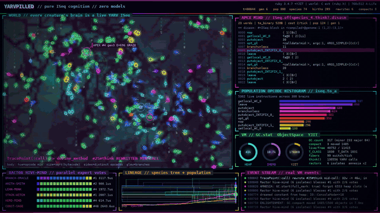
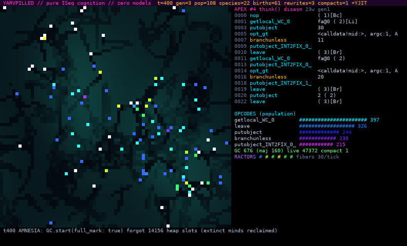

# YARVPILLED // pure ISeq cognition // zero models

A living A-Life world where **every creature's brain is real YARV bytecode**.
No neural nets, no ML libraries, no models: just CRuby. Creatures move, eat,
reproduce and die in real time. Each one thinks by executing a
`RubyVM::InstructionSequence`. That bytecode mutates when a creature
reproduces, and natural selection hot-swaps live methods through `TracePoint`.
Each creature's body (color, size, shape, glow) is computed from its own
opcode histogram.



| GC.compact "enlightenment" | TracePoint rewrite mid-call | terminal mode |
|---|---|---|
|  |  |  |

## Run it

Requires CRuby 3.3+ (3.4 + YJIT recommended), a C compiler for the optional
extension, and ffmpeg for video. Only the stdlib is used, with no gems.

```sh
rake compile                              # build ext/yarvpilled_native (ruby.h) + asm + Rust kernel (if cargo)
rake test                                 # minitest suite

ruby --yjit yarv_brain.rb --tui           # live ANSI truecolor terminal (Ctrl-C to quit)
ruby --yjit server.rb                     # live browser: http://localhost:4567/  (SSE at /events)
ruby --yjit yarv_brain.rb --video         # out/yarvpilled.mp4 + .gif + still_*.png + run_log.txt
ruby --yjit yarv_brain.rb --headless      # simulate, print the event log + stats
ruby yarv_brain.rb --bench --ticks=2000   # Ruby/YJIT/C/Rust/asm benchmark -> out/bench.md
ruby --yjit yarv_brain.rb --control       # selection vs drift control -> out/control.md
```

Options: `--world=native|c|asm|rust|ruby`, `--seed=N`, `--seconds=N`, `--fps=N`,
`--ticks-per-frame=N`, `--frames=N` (TUI), `--port=N --tps=N` (server).
If the extension isn't compiled, everything falls back to pure Ruby.

The video renderer outpaces real time on this box: 1260 frames of 1280x720
(42 s at 30 fps) render in about 34 s while the simulation runs. So the MP4
is a recording of a live run, not an offline composite.

## What's genuinely real vs. metaphor

| On screen | What actually happens in the VM |
|---|---|
| **Creature brain** | A Ruby lambda generated from a genome tree: `RubyVM::InstructionSequence.compile` → `#to_binary` → `.load_from_binary(...).eval` → `define_method(:think, &brain)` on a per-species `Class.new(Mind)`. Every tick, every creature calls `think(fa, fl, fr, en, cr, ag)` and YARV executes that block ISeq. **Real.** |
| **Mutation / reproduction** | When a child is born (30% chance), the genome tree is mutated (point, subtree, insert/delete statement, operator swap), re-rendered, and recompiled into a new species. **Real.** |
| **Body / phenotype** | Hue = CRC of the exact opcode multiset from `iseq.to_a`. Radius = √bytecode length. Polygon sides = distinct opcode count. Glow = branch count. Metabolic cost per tick = `1 + bytecode_len/22`, so bloated brains starve. **Real.** |
| **Natural selection rewrites live methods** | Every 150 ticks a targeted `TracePoint.new(:call).enable(target: weakest#think)` is armed. When YARV next enters that method, the hook fires *inside the call* (`caller_locations` shows `genome:2:block in <compiled>`) and `define_method`s a mutated copy of the apex genome. The in-flight call finishes on the old bytecode and the next call runs the new one. Both return values and the before/after disasm are logged in `run_log.txt`. **Real.** |
| **Apex disasm panel** | `RubyVM::InstructionSequence.of(apex.mind.class.instance_method(:think)).disasm`, i.e. the live method. **Real.** (The scrolling highlight bar is decoration, not a program counter.) |
| **Opcode rain** | Opcode names sampled from genomes compiled moments ago. **Real data, decorative motion.** |
| **Opcode histogram** | Sum of every living creature's `iseq.to_a` instructions. **Real.** |
| **Ractor hive-mind** | 6 `Ractor`s receive a `Ractor.make_shareable` table of candidate species and vote in parallel by their own taste (branch share, arithmetic share, leanness, ...). The winner's members get +90 energy. Latencies are measured inside each Ractor. **Real**; "expert" is the metaphor. |
| **Fiber attention** | Each tick, one `Fiber` per species runs its creatures' `think` calls, yielding every 8 creatures to a round-robin scheduler. The panel shows the switch count. **Real**, but it's cooperative scheduling, not attention math. |
| **GC.compact "enlightenment"** | `GC.compact` every 300 ticks. The flash shows `GC.latest_compact_info` (objects moved/considered, top types). **Real.** No zero-latency claims. |
| **GC "amnesia"** | Extinct species drop their only references to class, lambda and ISeq. `GC.start(full_mark: true, immediate_sweep: true)` reports how many heap slots were freed. **Real.** |
| **Refinement guardrail** | `using Guardrails` (lexically scoped to `simulation.rb`) refines `Integer#to_action` (`& 3`). Brains can return any Integer, and the clamp only exists where thought becomes action. A test asserts it doesn't leak. **Real.** |
| **prepend "jailbreak"** | When a thriving species collapses to 3 or fewer members, `Instinct` is prepended to its mind's singleton class: `en < 20 ? steer : super`. **Real.** |
| **ObjectSpace "hallucinations"** | Some mutation constants come from `ObjectSpace.each_object(Class)` (name length + method count, e.g. `DidYouMean::TreeSpellChecker=>38`). Only class names are read, never string contents. **Real**, and deliberately harmless. |
| **Gauges** | `GC.stat`, `ObjectSpace.count_objects` (T_IMEMO = ISeqs and friends), `RubyVM::YJIT.runtime_stats`. **Real.** |
| "Consciousness", "enlightenment", "hive-mind" | **Metaphor.** It's a genetic-programming A-Life sim whose genome happens to be YARV bytecode. |

## Architecture

```
yarv_brain.rb            CLI: --video / --tui / --headless / --bench / --control
server.rb                stdlib TCPServer + SSE; public/index.html canvas renderer
lib/yarvpilled/
  genome.rb              genome tree -> Ruby source -> ISeq -> to_binary -> brain; mutation; traits
  simulation.rb          tick loop, Fiber attention, births/deaths, TracePoint, Ractors, GC events
  guardrails.rb          Refinement guardrail, Instinct (prepend), Mind base class
  experts.rb             Ractor expert pool
  world.rb               picks the C or pure-Ruby world
  world_ruby.rb          pure-Ruby world, bit-identical to world.c
  renderer.rb, gfx.rb    1280x720 frame renderer, Canvas, PNG encoder, glyph atlas
  raster_ruby.rb         pure-Ruby fallback rasterizer
  telemetry.rb           JSON view of live state (SSE)
  tui.rb                 ANSI truecolor terminal mode
  video.rb               raw RGB24 -> ffmpeg (H.264, yuv420p), stills, GIF
  bench.rb               multi-tier benchmark (median/spread over fresh processes)
  control.rb             selection vs drift experiment, common-garden assay, permutation test
ext/yarvpilled_native/   world.c (Ruby glue), kernel_c.c (C kernel), crowd_x86_64.S (asm), raster.c
ext/yarvpilled_rust/     Rust world kernel (staticlib, C ABI)
tools/gen_font.rb        regenerates the DejaVu Sans Mono glyph atlases via ffmpeg drawtext
tools/ansi_to_png.rb     renders a captured TUI frame to PNG
```

**Division of labor.** The native kernels (C / Rust / asm) only move bodies: spatial hash grid,
resource regrowth, movement, eating, metabolism, collision, death and corpse
nutrients. It never decides anything. Decisions always come from YARV running
genome ISeqs. `world_ruby.rb` and the Rust kernel are line-for-line ports that use the
same integer and IEEE-754 operation order. `test_world_equivalence.rb`
asserts that all four backends stay bit-identical over 300 ticks with births.

## Benchmark: Ruby vs YJIT vs C vs Rust vs asm

`ruby yarv_brain.rb --bench --ticks=2000 --repeats=5`. Each tier runs as a fresh
process, 5 times; cells are **median (min-max)**. The world loop has four
interchangeable backends. All are bit-identical step by step
(`test/test_world_equivalence.rb`) and all share the same Ruby glue:

| backend | what it is |
|---|---|
| `ruby` | `lib/yarvpilled/world_ruby.rb`, pure Ruby |
| `c` | `ext/yarvpilled_native/kernel_c.c`, plain C99, `-O3` |
| `rust` | `ext/yarvpilled_rust`: the whole sense/act kernel in safe-ish Rust (staticlib, C ABI, no crates, LTO), linked into the same ruby.h extension and operating in place on the C-owned `#[repr(C)]` struct |
| `asm` | the C kernel with its hottest piece, the crowd-sensing spatial-hash scan, replaced by **hand-written x86-64 assembly** (`crowd_x86_64.S`, SysV, scalar SSE2, cmov-based grid wrap). This is real hand-written `.S`, not SIMD intrinsics. The loop chases a linked list, so there is no honest SIMD win available. |

Full sim = brains + world with events off and a fixed seed, so every run does
identical work (same checksum). "creatures/sec" means YARV `think()` calls per
second. The "time in ..." columns come from in-process timers around each tick
phase. "World via Ruby API" includes the Array <-> buffer glue; "kernel only"
times the native kernels with no Ruby involved.

ruby 3.4.7 | Intel(R) Xeon(R) Processor | 8 cpus | seed 11 | 2000 ticks | 5 runs per tier, each a fresh process | values are **median (min-max)**

### Full simulation (brains + world)

| tier | creatures/sec | generations/sec | ticks/sec | vs pure Ruby | time in brains (YARV think) | time compiling births (mutate+ISeq) | time in world (sense+act) | spread | checksum |
|---|---:|---:|---:|---:|---:|---:|---:|---:|---|
| pure Ruby interpreter | 79,543 (71,055-80,313) | 2.10 (1.87-2.12) | 466 (417-471) | 1.00x | 17% | 3% | 80% | 11.6% | `557-9-178-1263170-160` |
| pure Ruby + YJIT | 147,949 (139,349-155,673) | 3.90 (3.68-4.11) | 867 (817-913) | 1.86x | 31% | 6% | 63% | 11.0% | `557-9-178-1263170-160` |
| C + YJIT | 278,971 (265,787-303,899) | 7.36 (7.01-8.02) | 1,636 (1,558-1,782) | 3.51x | 72% | 13% | 15% | 13.7% | `557-9-178-1263170-160` |
| Rust + YJIT | 270,977 (254,027-287,471) | 7.15 (6.70-7.59) | 1,589 (1,489-1,686) | 3.41x | 70% | 12% | 17% | 12.3% | `557-9-178-1263170-160` |
| asm + YJIT | 275,521 (246,846-280,025) | 7.27 (6.51-7.39) | 1,616 (1,447-1,642) | 3.46x | 72% | 13% | 14% | 12.0% | `557-9-178-1263170-160` |
| C, interpreter (extra) | 215,625 (189,853-220,369) | 5.69 (5.01-5.81) | 1,264 (1,113-1,292) | 2.71x | 76% | 9% | 14% | 14.2% | `557-9-178-1263170-160` |

### World loop only (no brains)

| tier | world via Ruby API (updates/sec) | vs pure Ruby | kernel only, no Ruby glue (updates/sec) | crowd scan (ns/creature) | spread (API) |
|---|---:|---:|---:|---:|---:|
| pure Ruby interpreter | 145,500 (137,090-154,603) | 1.0x | n/a | n/a | 12.0% |
| pure Ruby + YJIT | 357,931 (354,188-371,538) | 2.5x | n/a | n/a | 4.8% |
| C + YJIT | 3,202,418 (2,860,074-3,352,682) | 22.0x | 3,792,146 (3,729,232-3,852,531) | 103.1 (99.4-106.7) | 15.4% |
| Rust + YJIT | 2,706,854 (2,654,423-2,776,398) | 18.6x | 3,089,648 (2,817,091-3,195,424) | n/a | 4.5% |
| asm + YJIT | 2,884,147 (2,787,973-3,074,170) | 19.8x | 3,509,464 (3,248,720-3,778,834) | 104.5 (101.5-111.9) | 9.9% |
| C, interpreter (extra) | 2,807,776 (2,487,747-3,035,365) | 19.3x | 3,584,645 (2,980,834-3,629,377) | 108.6 (107.7-157.3) | 19.5% |

Identical full-sim checksum across all 30 runs: **true** (`557-9-178-1263170-160`; births-maxgen-alive-food_eaten-species). The world backends are also bit-identical step by step (test/test_world_equivalence.rb).

**Verdict.** Once the world loop is native, YARV dominates: about 72% of each
tick is creatures executing their bytecode brains, about 13% is compiling new
genome ISeqs, and only about 15% is the world. So C, Rust and hand-written asm
land within each other's run-to-run spread on the full simulation (3.4-3.5x
over pure Ruby).
- On the bare world kernel, C is fastest: 3.79M updates/s, vs 3.51M for asm and
  3.09M for Rust.
- The hand-written asm crowd scan only ties gcc -O3 (about 103-105 ns per
  creature).
- The remaining lever is the brains themselves (YJIT on genome ISeqs), not the
  world.

## Control: selection vs random drift

`ruby --yjit yarv_brain.rb --control --replicates=8 --ticks=4000`. Without this
control, "evolution" could just be mutation noise. The null model keeps
everything identical (same seeds, same mutation rate, brains still executed)
except that genomes can't affect fitness: actions are randomized and
metabolic cost is flat.

8 seeds x 2 conditions, 4000 ticks each, events off, world=native. Selection: brain output drives behaviour, cost scales with bytecode. Drift (null model): brain still runs, actions are random, cost is flat, so genomes carry no fitness signal. Common-garden assay: top 8 species per population (abundance-weighted), 40 clones each, 300 ticks, flat cost, no reproduction. Test: exact two-sided permutation test on the difference of means (all C(16,8) = 12870 relabelings), with Holm-Bonferroni correction across the 6 metrics. The hand-written seed genome scores fitness 4.438 and survival 0.55 in the same assay.

| metric | selection mean +/- sd | drift mean +/- sd | diff | Cohen's d | permutation p | Holm-adjusted p |
|---|---:|---:|---:|---:|---:|---:|
| assay fitness (energy intake / creature-tick) | 5.009 +/- 0.472 | 4.417 +/- 0.410 | +0.592 | 1.34 | 0.0190 | 0.0379 |
| assay survival (fraction alive after 300 ticks) | 0.708 +/- 0.114 | 0.512 +/- 0.090 | +0.196 | 1.91 | 0.0030 | 0.0089 |
| species entropy (bits) | 5.209 +/- 0.327 | 6.040 +/- 0.196 | -0.831 | -3.08 | 0.0002 | 0.0009 |
| opcode entropy (bits) | 3.286 +/- 0.191 | 3.642 +/- 0.063 | -0.357 | -2.50 | 0.0002 | 0.0009 |
| mean bytecode length (words) | 32.523 +/- 7.740 | 54.176 +/- 6.850 | -21.652 | -2.96 | 0.0002 | 0.0009 |
| final population (in-sim, context only) | 209.500 +/- 29.394 | 182.250 +/- 21.110 | +27.250 | 1.06 | 0.0485 | 0.0485 |

Per-replicate rows: [docs/control.json](docs/control.json).

p = 0.0002 is the floor of the exact test (2/12870), meaning complete
separation of the two groups. Selection produces measurably better foragers
than drift: +13% intake (the hand-written seed scores 4.438) and +38%
survival. It also purges bytecode bloat (33 vs 54 words) and collapses
diversity (lower species and opcode entropy). All three hold after Holm
correction. Caveat: n = 8 per arm, one assay arena, 4000 ticks (about 10
generations).

## Found along the way

YJIT in Ruby 3.4.7 panicked (`x86_split: assertion failed: opnds.len() <=
C_ARG_OPNDS.len()`) when it direct-called this extension's fixed-arity C
functions with more than 5 arguments. The workaround: every many-argument
entry point is registered as variadic (`argc, argv`). See the comment in
`raster.c`.

## License

MIT. See [LICENSE](LICENSE).
