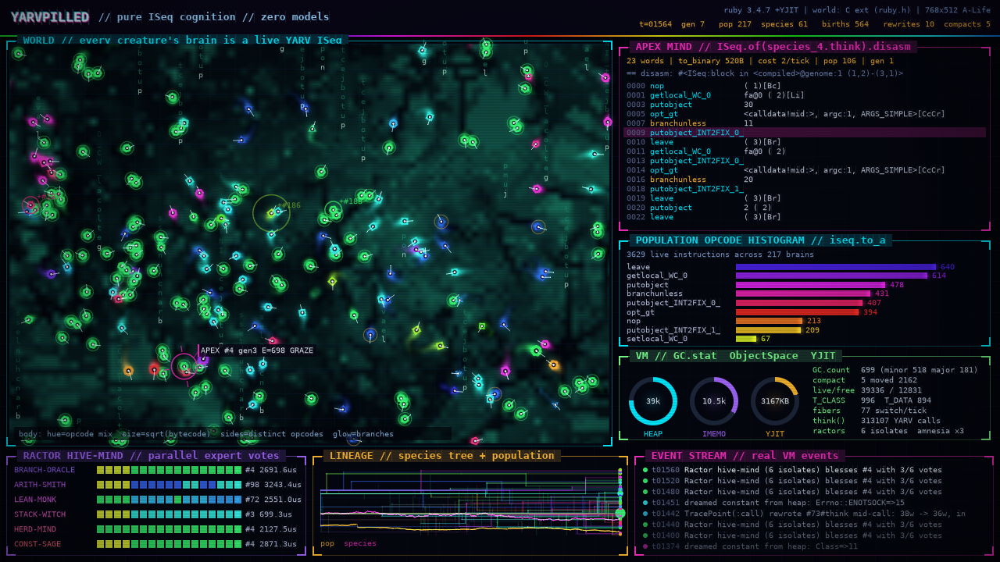
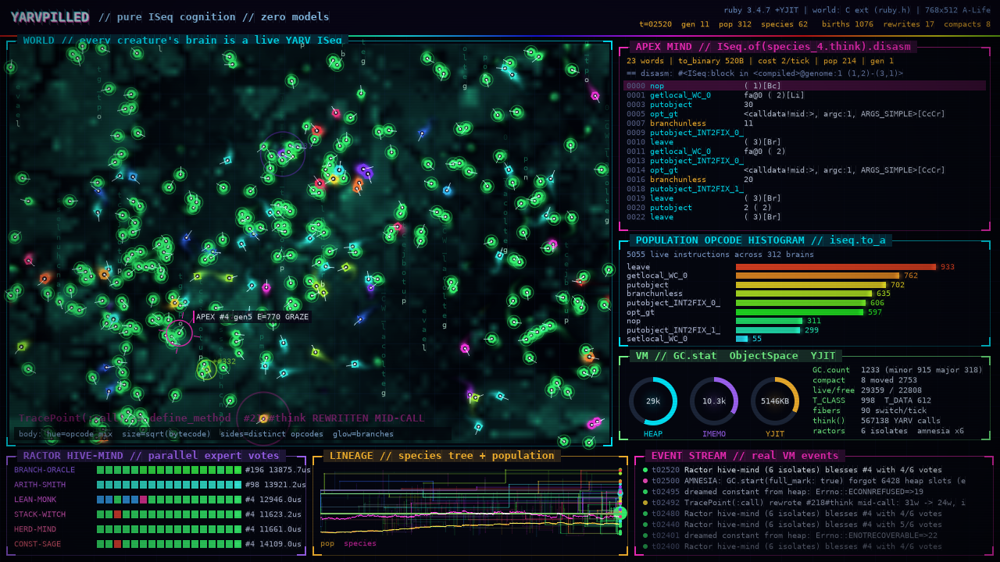
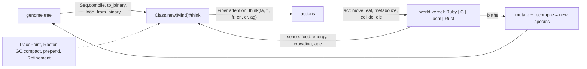

<div align="center">

# YARVPILLED

**An A-Life world where every creature's brain is a live YARV instruction sequence.**
Zero models. Pure CRuby. World loop in Ruby, C, Rust or hand-written x86-64 asm, all bit-identical.

[](https://github.com/0thernes/yarvpilled/actions/workflows/ci.yml)
[](https://github.com/0thernes/yarvpilled/releases)
[](LICENSE)
[](https://www.ruby-lang.org/)
[](https://docs.ruby-lang.org/en/3.4/yjit/yjit_md.html)
[](docs/adr/0003-stdlib-only.md)
[](https://0thernes.github.io/yarvpilled/)
[](https://github.com/0thernes/yarvpilled/actions/workflows/verify.yml)
[](docs/verification.md)
[](formal/lean/README.md)
[](CLAIMS.md)
[](docs/preregistration.md)

**[Watch it in your browser](https://0thernes.github.io/yarvpilled/)**: a replay of a real CRuby run, recorded by CI.


</div>

Creatures move, eat, reproduce and die in real time. Each one thinks by executing a
`RubyVM::InstructionSequence` compiled from its genome. The genome's bytecode mutates when a
creature reproduces, natural selection hot-swaps live methods through `TracePoint`, and each
creature's body (color, size, shape, glow) is computed from its own opcode histogram.

| GC.compact "enlightenment" | TracePoint rewrite mid-call | terminal mode |
|---|---|---|
|  |  |  |
| **browser mode (SSE + canvas)** | **the living world** | **end of a 40 s run** |
|  |  |  |

## Contents

[Results](#results-at-a-glance) · [Quickstart](#quickstart) · [Usage](#usage) ·
[Architecture](#architecture) · [Real vs. metaphor](#whats-genuinely-real-vs-metaphor) ·
[Benchmarks](#benchmarks-ruby-vs-yjit-vs-c-vs-rust-vs-asm) · [Control experiment](#control-selection-vs-random-drift) ·
[Limitations](#limitations) · [Verification](#verification) · [Docs](#documentation) · [Citation](#citation) · [License](#license)

## Results at a glance

<!-- generated:speed-glance -->
Speed, median of 5 fresh processes per tier (seed 11, 2000 ticks; identical checksum `557-9-178-1263170-160` in all 30 runs) [C-BENCH-1, C-BENCH-3]:

| tier | creatures/sec | vs pure Ruby | world loop only (updates/sec) | share of tick in YARV brains |
|---|---:|---:|---:|---:|
| pure Ruby interpreter | 74,747 | 1.00x | 137,687 | 18% |
| pure Ruby + YJIT | 139,866 | 1.87x | 349,480 | 32% |
| C + YJIT | 243,619 | 3.26x | 2,848,731 | 72% |
| Rust + YJIT | 251,895 | 3.37x | 2,498,088 | 70% |
| asm + YJIT | 262,779 | 3.52x | 3,046,347 | 72% |
<!-- /generated:speed-glance -->

<!-- generated:evolution-glance -->
Evolution, 20 seeds per arm (pre-registered), against a random-drift null model [C-CTRL-1, C-CTRL-2]:

| metric | selection | drift | difference [95% CI] | Holm-adjusted p |
|---|---:|---:|---:|---:|
| foraging fitness (common-garden assay) | 5.073 | 4.472 | +0.601 [+0.314, +0.909] | 8.0e-04 |
| survival in assay | 0.734 | 0.566 | +0.168 [+0.092, +0.248] | 3.6e-04 |
| mean bytecode length (words) | 34.5 | 52.4 | -17.9 [-21.1, -15.0] | 6.0e-05 |
<!-- /generated:evolution-glance -->

**Verdict.** C, Rust and hand-written asm are tied within run-to-run noise (about 3.3-3.5x pure
Ruby end to end, about 20x on the world loop). Once the world is native, about 70% of each tick
is YARV running genome bytecode, so the brains set the speed, not the language of the world
loop. Selection beats drift on every pre-registered hypothesis. Every claim has an ID, a command
and a test: [CLAIMS.md](CLAIMS.md). How we tried to break it: [docs/verification.md](docs/verification.md).

## Quickstart

Requirements: **CRuby 3.3+** (3.4 with YJIT recommended). Optional: a C compiler for the
native world (falls back to pure Ruby without one), **cargo** for the Rust backend, and
**ffmpeg** for `--video`. There are no gems to install.

### Linux

```sh
sudo apt install ruby-full build-essential ffmpeg       # or your distro's equivalents / a Ruby manager
curl https://sh.rustup.rs -sSf | sh                     # optional: Rust backend
git clone https://github.com/0thernes/yarvpilled && cd yarvpilled
rake compile && rake test
ruby --yjit yarv_brain.rb --tui
```

### macOS

```sh
xcode-select --install                                  # clang + make
brew install ruby ffmpeg rust                           # Homebrew Ruby (3.4) is YJIT-enabled
git clone https://github.com/0thernes/yarvpilled && cd yarvpilled
rake compile && rake test                               # :asm needs x86-64 Linux/BSD; on macOS it uses the C scan
ruby --yjit yarv_brain.rb --tui
```

### As a gem (from a clone; not on RubyGems yet)

```sh
rake gem && gem install pkg/yarvpilled-*.gem    # compiles the C ext on install (Rust backend is repo-only)
yarvpilled --tui                                # same CLI as yarv_brain.rb; output goes to ./out
```

### Windows (RubyInstaller + DevKit)

```powershell
winget install RubyInstallerTeam.RubyWithDevKit.3.4     # or download "Ruby+Devkit 3.4" from rubyinstaller.org
ridk install                                            # choose option 3 (MSYS2 + MINGW toolchain)
git clone https://github.com/0thernes/yarvpilled; cd yarvpilled
rake compile                                            # builds the C world via DevKit, or falls back to pure Ruby
rake test
ruby yarv_brain.rb --tui                                # use Windows Terminal for truecolor
```

On Windows, `rake compile` enables the DevKit toolchain itself and skips the Rust and asm
backends. If the C build fails for any reason, it prints a warning and everything runs on the
bit-identical pure-Ruby world. You can force that path anywhere with `YARVPILLED_PURE=1`.
`ruby yarv_brain.rb --version` shows which backends are available.

## Usage

```sh
ruby --yjit yarv_brain.rb --tui           # live ANSI truecolor terminal (Ctrl-C to quit)
ruby --yjit server.rb                     # live browser: http://localhost:4567/  (SSE at /events)
ruby --yjit yarv_brain.rb --video         # out/yarvpilled.mp4 + .gif + still_*.png + run_log.txt
ruby --yjit yarv_brain.rb --headless      # simulate, print the event log + stats
ruby yarv_brain.rb --bench                # benchmark every available tier -> out/bench.md
ruby --yjit yarv_brain.rb --control       # selection vs drift experiment -> out/control.md
ruby yarv_brain.rb --version              # version + available world backends
```

Options: `--world=native|c|asm|rust|ruby`, `--seed=N`, `--ticks=N`, `--seconds=N`, `--fps=N`,
`--ticks-per-frame=N`, `--frames=N` (TUI), `--repeats=N` (bench), `--replicates=N` (control),
`--out=DIR`. Server: `--port=N --bind=ADDR --tps=N --world=KIND`. It binds to 127.0.0.1 by default.

### Rake tasks

| task | what it does |
|---|---|
| `rake compile` | Builds the ruby.h C extension, plus x86-64 asm on Linux/BSD and the Rust kernel if cargo is present. Falls back to pure Ruby on failure (`YP_STRICT=1` makes failure fatal; `YP_NO_RUST=1` skips Rust). |
| `rake test` | Runs the minitest suite. Native-only tests are skipped when the extension is absent. |
| `rake smoke` | Prints `--version`, then does a 300-tick headless run. |
| `rake bench` | Multi-tier benchmark (`REPEATS=5 TICKS=2000`), written to `out/bench.md` and `.json`. |
| `rake control` | The pre-registered selection-vs-drift run (`REPLICATES=20 FIRST_SEED=201 TICKS=4000`, `WORKERS` = CPU count), written to `out/control.md` and `.json`. |
| `rake video` | Renders the MP4, GIF, stills and run log (needs ffmpeg). |
| `rake site` | Builds the GitHub Pages demo into `_site/` (a 900-tick replay of a real run). |
| `rake gem` | Builds `pkg/yarvpilled-VERSION.gem`. |
| `rake labels` | Syncs the issue labels with `gh` (`DRY=1` prints the commands). |
| `rake clean` | Removes `tmp/`, `_site/`, `pkg/`, the compiled extension and the Rust `target/`. |
| `rake` | Runs `compile`, then `test`. |

Prefer [`just`](https://github.com/casey/just)? `just --list` shows the same recipes (it works on Windows too).

The video renderer outpaces real time on a modern CPU: 1260 frames of 1280x720 (42 s at 30 fps)
render in about 34 s while the simulation runs. So the MP4 is a recording of a live run, not an
offline composite.

## Architecture



**Division of labor.** The world kernels (Ruby / C / Rust / asm) only move bodies: spatial
hash grid, resource regrowth, movement, eating, metabolism, collision, death and corpse
nutrients. They never decide anything. Decisions always come from YARV running genome ISeqs.
All four backends use the same integer and IEEE-754 operation order (no FMA), and
`test/test_world_equivalence.rb` and `test/test_differential.rb` assert they stay bit-identical
(and equal to a deliberately simple reference stepper) over hundreds of random worlds.
Details: [docs/architecture.md](docs/architecture.md) and the [ADRs](docs/adr/README.md).

## What's genuinely real vs. metaphor

| On screen | What actually happens in the VM |
|---|---|
| **Creature brain** | A Ruby lambda generated from a genome tree: `RubyVM::InstructionSequence.compile` → `#to_binary` → `.load_from_binary(...).eval` → `define_method(:think, &brain)` on a per-species `Class.new(Mind)`. Every tick, every creature calls `think(fa, fl, fr, en, cr, ag)` and YARV executes that block ISeq. **Real.** |
| **Mutation / reproduction** | When a child is born (30% chance), the genome tree is mutated (point, subtree, insert/delete statement, operator swap), re-rendered, and recompiled into a new species. **Real.** |
| **Body / phenotype** | Hue = CRC of the exact opcode multiset from `iseq.to_a`. Radius = √bytecode length. Polygon sides = distinct opcode count. Glow = branch count. Energy drain per tick = `3 + cost` (`+3` when dashing), with genome cost `1 + bytecode_len/22`, so bloated brains starve. **Real.** |
| **Natural selection rewrites live methods** | Every 150 ticks a targeted `TracePoint.new(:call).enable(target: weakest#think)` is armed. When YARV next enters that method, the hook fires *inside the call* (`caller_locations` shows `genome:2:block in <compiled>`) and `define_method`s a mutated copy of the apex genome. The in-flight call finishes on the old bytecode and the next call runs the new one. Both return values and the before/after disasm are logged in `run_log.txt`. **Real.** |
| **Apex disasm panel** | `RubyVM::InstructionSequence.of(apex.mind.class.instance_method(:think)).disasm`, i.e. the live method. **Real.** (The scrolling highlight bar is decoration, not a program counter.) |
| **Opcode rain** | Opcode names sampled from genomes compiled moments ago. **Real data, decorative motion.** |
| **Opcode histogram** | Sum of every living creature's `iseq.to_a` instructions. **Real.** |
| **Ractor hive-mind** | 6 `Ractor`s receive a `Ractor.make_shareable` table of candidate species and vote in parallel by their own taste (branch share, arithmetic share, leanness, ...). The winner's members get +90 energy. Latencies are measured inside each Ractor. **Real**; "expert" is the metaphor. |
| **Fiber attention** | Each tick, one `Fiber` per species runs its creatures' `think` calls, yielding every 8 creatures to a round-robin scheduler. The panel shows the switch count. **Real**, but it's cooperative scheduling, not attention math. |
| **GC.compact "enlightenment"** | `GC.compact` every 300 ticks. The flash shows `GC.latest_compact_info` (objects moved/considered, top types). **Real.** No zero-latency claims. |
| **GC "amnesia"** | Extinct species drop their only references to class, lambda and ISeq. `GC.start(full_mark: true, immediate_sweep: true)` reports how many heap slots were freed. **Real.** |
| **Refinement guardrail** | `using Guardrails` (lexically scoped to `simulation.rb`) refines `Integer#to_action` (`& 3`). Brains can return any Integer, and the clamp only exists where thought becomes action. A test asserts it doesn't leak. **Real.** |
| **prepend "jailbreak"** | When a thriving species collapses to 3 or fewer members, `Instinct` is prepended to its mind's singleton class: `en < 20 ? steer : super`. **Real.** |
| **ObjectSpace "hallucinations"** | Some mutation constants come from `ObjectSpace.each_object(Class)` (name length + method count, e.g. `DidYouMean::TreeSpellChecker=>38`). Only class names are read, never string contents. **Real**, and deliberately harmless. |
| **Gauges** | `GC.stat`, `ObjectSpace.count_objects` (T_IMEMO = ISeqs and friends), `RubyVM::YJIT.runtime_stats`. **Real.** |
| "Consciousness", "enlightenment", "hive-mind" | **Metaphor.** It's a genetic-programming A-Life sim whose genome happens to be YARV bytecode. |

## Benchmarks: Ruby vs YJIT vs C vs Rust vs asm

`rake bench` (= `ruby yarv_brain.rb --bench --ticks=2000 --repeats=5`). Each tier runs as a fresh
process, 5 times; cells are **median (min-max)**. The world loop has four
interchangeable backends. All are bit-identical step by step
(`test/test_world_equivalence.rb`) and all share the same Ruby glue:

| backend | what it is |
|---|---|
| `ruby` | `lib/yarvpilled/world_ruby.rb`, pure Ruby |
| `c` | `ext/yarvpilled_native/kernel_c.c`, plain C99, `-O3` |
| `rust` | `ext/yarvpilled_rust`: the whole sense/act kernel in safe-ish Rust (staticlib, C ABI, no crates, LTO), linked into the same ruby.h extension and operating in place on the C-owned `#[repr(C)]` struct |
| `asm` | the C kernel with its hottest piece, the crowd-sensing spatial-hash scan, replaced by **hand-written x86-64 assembly** (`crowd_x86_64.S`, SysV, scalar SSE2, cmov-based grid wrap). This is real hand-written `.S`, not SIMD intrinsics. The loop chases a linked list, so there is no honest SIMD win available. |

Full sim = brains + world with events off and a fixed seed, so every run does
identical work (same checksum). "creatures/sec" means YARV `think()` calls per
second. The "time in ..." columns come from in-process timers around each tick
phase. "World via Ruby API" includes the Array <-> buffer glue; "kernel only"
times the native kernels with no Ruby involved.

<!-- generated:bench-tables -->
| tier | creatures/sec, median (min-max) | vs pure Ruby | brains | world | spread | world via Ruby API (updates/sec) | kernel only (updates/sec) | crowd scan (ns) |
|---|---:|---:|---:|---:|---:|---:|---:|---:|
| pure Ruby interpreter | 74,747 (68,142-81,448) | 1.00x | 18% | 80% | 17.8% | 137,687 | n/a | n/a |
| pure Ruby + YJIT | 139,866 (127,136-144,177) | 1.87x | 32% | 62% | 12.2% | 349,480 | n/a | n/a |
| C + YJIT | 243,619 (202,250-276,294) | 3.26x | 72% | 14% | 30.4% | 2,848,731 | 3,246,770 | 119.6 |
| Rust + YJIT | 251,895 (233,588-263,868) | 3.37x | 70% | 16% | 12.0% | 2,498,088 | 2,890,079 | n/a |
| asm + YJIT | 262,779 (257,459-282,998) | 3.52x | 72% | 14% | 9.7% | 3,046,347 | 3,496,816 | 107.1 |
| C, interpreter (extra) | 223,338 (179,262-228,487) | 2.99x | 76% | 14% | 22.0% | 3,076,142 | 3,506,024 | 109.6 |

Correctness next to every timing: all 30 runs produced checksum `557-9-178-1263170-160`, and every world-loop timing ended on state digest `699cb7c5dfcb0295` [C-BENCH-1, C-BENCH-2].
Recorded on: Intel(R) Xeon(R) Processor, 8 logical CPUs, container-other, load average 4.87 4.15 3.36 at start, ruby 3.4.7, gcc (Debian 14.2.0-19), rustc 1.85.1 (4eb161250 2025-03-15) (built from a source tarball).
<!-- /generated:bench-tables -->

**Verdict.**

<!-- generated:bench-verdict -->
- End to end, the native tiers are 3.26-3.52x pure Ruby. Their medians differ by at most 7.9%, less than the smallest run-to-run spread among them (9.7%; largest 30.4%), so they are tied within noise [C-BENCH-3].
- About 70-72% of each native tick is YARV running genome bytecode, so the brains set the speed, not the world loop's language [C-BENCH-4].
- On the world loop alone, native backends are 18-22x pure Ruby through the Ruby API [C-BENCH-5]. Fastest bare kernel in this run: asm + YJIT (3,496,816 updates/s).
- Crowd scan: C 119.6 ns, asm 107.1 ns per creature. The hand-written asm is in the same range as gcc -O3, not a big win [C-BENCH-6].
<!-- /generated:bench-verdict -->

Each timing sits next to its correctness check, losses included: the full report with
hardware details, per-phase shares and min-max ranges is [docs/bench.md](docs/bench.md), and the
previous run is kept as [docs/bench_v0.2.0.md](docs/bench_v0.2.0.md). The box this ran on was
busy (see the load average), which is why spreads reach 20-30%.

## Control: selection vs random drift

`rake control` (= `ruby --yjit yarv_brain.rb --control --replicates=20 --first-seed=201 --ticks=4000`).
Without this control, "evolution" could just be mutation noise. The null model keeps everything
identical (same seeds, same mutation rate, brains still executed) except that genomes can't
affect fitness: actions are randomized and metabolic cost is flat.

The confirmatory run was **pre-registered** ([docs/preregistration.md](docs/preregistration.md),
committed in `316a27f`, two minutes before the results commit `a6aed90`; git shows the commit
order, not when the run itself happened): hypotheses, seeds 201-220, n = 20 per arm, the test
(two-sided permutation test on the difference of means, Monte Carlo with 100,000 seeded
relabelings, Holm correction) and the decision rule. Effect sizes come with 95% percentile
bootstrap CIs (10,000 resamples). Common-garden assay: top 8 species per population
(abundance-weighted), 40 clones each, 300 ticks, flat cost, no reproduction.

<!-- generated:control-table -->
| metric | selection mean +/- sd | drift mean +/- sd | diff [95% CI] | Cohen's d [95% CI] | Holm-adjusted p |
|---|---:|---:|---:|---:|---:|
| assay fitness (energy intake / creature-tick) | 5.073 +/- 0.632 | 4.472 +/- 0.293 | +0.601 [+0.314, +0.909] | 1.22 [0.73, 1.86] | 8.0e-04 |
| assay survival (fraction alive after 300 ticks) | 0.734 +/- 0.166 | 0.566 +/- 0.075 | +0.168 [+0.092, +0.248] | 1.30 [0.82, 1.97] | 3.6e-04 |
| species entropy (bits) | 5.194 +/- 0.407 | 6.126 +/- 0.163 | -0.932 [-1.127, -0.750] | -3.01 [-3.97, -2.50] | 6.0e-05 |
| opcode entropy (bits) | 3.355 +/- 0.060 | 3.611 +/- 0.041 | -0.257 [-0.287, -0.225] | -4.99 [-7.47, -3.84] | 6.0e-05 |
| mean bytecode length (words) | 34.506 +/- 2.995 | 52.411 +/- 6.579 | -17.905 [-21.104, -14.969] | -3.50 [-5.23, -2.73] | 6.0e-05 |
| final population (in-sim, context only) | 214.850 +/- 33.875 | 189.800 +/- 22.867 | +25.050 [+8.450, +43.150] | 0.87 [0.34, 1.46] | 0.0077 |

n = 20 seeds per arm, seeds 201-220, 4000 ticks. The hand-written seed genome scores fitness 4.438 and survival 0.550 in the same assay.
<!-- /generated:control-table -->

All five pre-registered hypotheses (H1 fitness, H2 survival, H3 bytecode length, H4 species
entropy, H5 opcode entropy) are supported. Selection produces better foragers than drift, purges
bytecode bloat and collapses diversity. Per-replicate rows: [docs/control.json](docs/control.json);
full report and run record: [docs/control.md](docs/control.md); the earlier 8-seed pilot:
[docs/control_pilot.md](docs/control_pilot.md). Caveats: one assay arena, 4000 ticks (about 10-15
generations).

## Limitations

The short version: one benchmark machine (busy, virtualized), one assay arena, about 10-15
generations, events-on runs aren't bit-reproducible, macOS is checked only by CI and Windows
only in pure Ruby on the author's PC, and the Lean proofs cover the integer bookkeeping, not the floating-point geometry. "Consciousness" and
"hive-mind" are labels for the visuals. The full list, and **what would prove us wrong**:
[LIMITATIONS.md](LIMITATIONS.md).

## Verification

A 14-layer ladder of attempts to prove this project wrong: pinned toolchains and a one-command
`just reproduce`, claim IDs, negative and property-based tests, differential testing against a
slow reference stepper, mutation testing, fuzzing under ASan/UBSan, a Lean 4 spec with proved
invariants, CBMC proofs on the C kernel, Kani harnesses, pre-registered statistics, release
provenance, and an open call for replications.

Status, from the recorded runs: 10 layers verified on the dev box; 4 partial (mutation
testing covers the Ruby side only, 88.5%; formal methods: Lean 31/31 theorems and CBMC 5/6
harnesses, but the whole-tick CBMC harness did not finish and Kani runs in CI only; release
provenance: checksums and the source tarball check out and every asset has an attestation,
but the signatures were not verified here; replication so far comes from the author's own
machines only). Per-layer detail and reasons: [docs/verification.md](docs/verification.md).
Replicate it: [REPLICATION.md](REPLICATION.md).

## Found along the way

YJIT in Ruby 3.4.7 panicked (`x86_split: assertion failed: opnds.len() <=
C_ARG_OPNDS.len()`) when it direct-called this extension's fixed-arity C
functions with more than 5 arguments. The workaround: every many-argument
entry point is registered as variadic (`argc, argv`). See the comment in
`raster.c`.

## Documentation

- [docs/architecture.md](docs/architecture.md): tick loop, backends, fallbacks, file map
- [docs/adr/](docs/adr/README.md): architecture decision records
- [docs/bench.md](docs/bench.md) / [bench.json](docs/bench.json): full benchmark report
- [docs/control.md](docs/control.md) / [control.json](docs/control.json): selection vs drift report
- [CLAIMS.md](CLAIMS.md): every claim, its command and its test
- [docs/verification.md](docs/verification.md): the verification ladder, status per layer
- [LIMITATIONS.md](LIMITATIONS.md) · [REPLICATION.md](REPLICATION.md) · [docs/provenance.md](docs/provenance.md)
- [docs/faq.md](docs/faq.md): FAQ
- [ROADMAP.md](ROADMAP.md): what's next
- [docs/run_log.txt](docs/run_log.txt): log of the run shown in the GIF (TracePoint rewrites with before/after disasm)
- [CHANGELOG.md](CHANGELOG.md) · [CONTRIBUTING.md](CONTRIBUTING.md) · [SECURITY.md](SECURITY.md) · [SUPPORT.md](SUPPORT.md) · [CODE_OF_CONDUCT.md](CODE_OF_CONDUCT.md)

## Citation

If you use this project or its numbers, please cite it. GitHub's "Cite this repository" button
reads [CITATION.cff](CITATION.cff).

```bibtex
@software{yarvpilled_2026,
  author  = {0thernes},
  title   = {yarvpilled: an A-Life world where every brain is a live YARV instruction sequence},
  year    = {2026},
  version = {0.4.0},
  url     = {https://github.com/0thernes/yarvpilled},
  license = {MIT}
}
```

## License

[MIT](LICENSE) © 2026 0thernes
