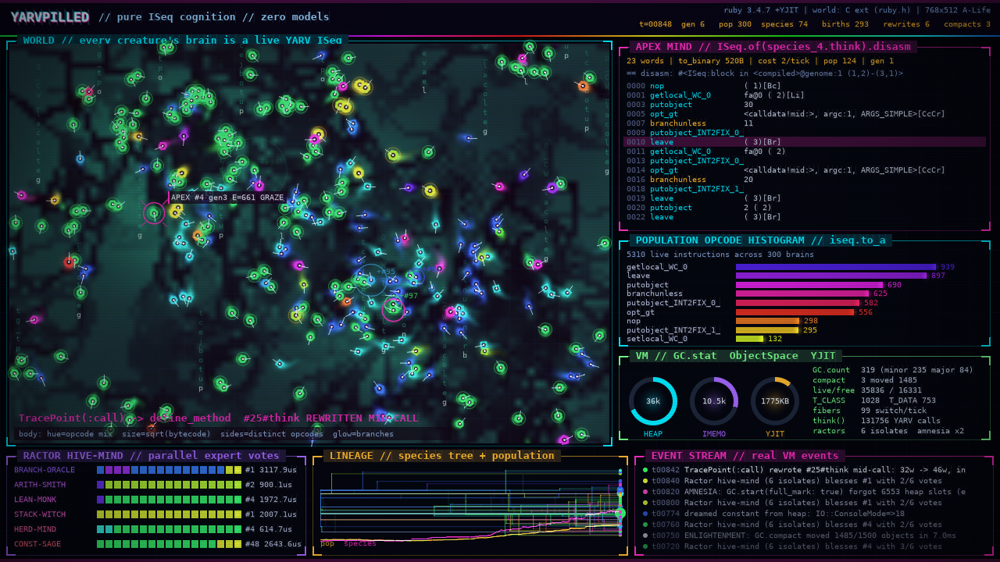

# YARVPILLED // pure ISeq cognition // zero models

A living A-Life world where **every creature's brain is real YARV bytecode**.
No neural nets, no ML libraries, no models: just CRuby. Creatures move, eat,
reproduce and die in real time. Each one thinks by executing a
`RubyVM::InstructionSequence`. That bytecode mutates when a creature
reproduces, and natural selection hot-swaps live methods through `TracePoint`.
Each creature's body (color, size, shape, glow) is computed from its own
opcode histogram.


| GC.compact "enlightenment" | TracePoint rewrite mid-call | terminal mode |
|---|---|---|
|  |  |  |

## Run it

Requires CRuby 3.3+ (3.4 + YJIT recommended), a C compiler for the optional
extension, and ffmpeg for video. Only the stdlib is used, with no gems.

```sh
rake compile                              # build ext/yarvpilled_native (ruby.h only)
rake test                                 # minitest suite

ruby --yjit yarv_brain.rb --tui           # live ANSI truecolor terminal (Ctrl-C to quit)
ruby --yjit server.rb                     # live browser: http://localhost:4567/  (SSE at /events)
ruby --yjit yarv_brain.rb --video         # out/yarvpilled.mp4 + .gif + still_*.png + run_log.txt
ruby --yjit yarv_brain.rb --headless      # simulate, print the event log + stats
ruby yarv_brain.rb --bench --ticks=2000   # 3-tier benchmark -> out/bench.md
```

Options: `--world=native|ruby`, `--seed=N`, `--seconds=N`, `--fps=N`,
`--ticks-per-frame=N`, `--frames=N` (TUI), `--port=N --tps=N` (server).
If the extension isn't compiled, everything falls back to pure Ruby.

The video renderer outpaces real time on this box: 1260 frames of 1280x720
(42 s at 30 fps) render in about 34 s while the simulation runs. So the MP4
is a recording of a live run, not an offline composite.

## What's genuinely real vs. metaphor

| On screen | What actually happens in the VM |
|---|---|
| **Creature brain** | A Ruby lambda generated from a genome tree: `RubyVM::InstructionSequence.compile` → `#to_binary` → `.load_from_binary(...).eval` → `define_method(:think, &brain)` on a per-species `Class.new(Mind)`. Every tick, every creature calls `think(fa, fl, fr, en, cr, ag)` and YARV executes that block ISeq. **Real.** |
| **Mutation / reproduction** | When a child is born (30% chance), the genome tree is mutated (point, subtree, insert/delete statement, operator swap), re-rendered, and recompiled into a new species. **Real.** |
| **Body / phenotype** | Hue = CRC of the exact opcode multiset from `iseq.to_a`. Radius = √bytecode length. Polygon sides = distinct opcode count. Glow = branch count. Metabolic cost per tick = `1 + bytecode_len/22`, so bloated brains starve. **Real.** |
| **Natural selection rewrites live methods** | Every 150 ticks a targeted `TracePoint.new(:call).enable(target: weakest#think)` is armed. When YARV next enters that method, the hook fires *inside the call* (`caller_locations` shows `genome:2:block in <compiled>`) and `define_method`s a mutated copy of the apex genome. The in-flight call finishes on the old bytecode and the next call runs the new one. Both return values and the before/after disasm are logged in `run_log.txt`. **Real.** |
| **Apex disasm panel** | `RubyVM::InstructionSequence.of(apex.mind.class.instance_method(:think)).disasm`, i.e. the live method. **Real.** (The scrolling highlight bar is decoration, not a program counter.) |
| **Opcode rain** | Opcode names sampled from genomes compiled moments ago. **Real data, decorative motion.** |
| **Opcode histogram** | Sum of every living creature's `iseq.to_a` instructions. **Real.** |
| **Ractor hive-mind** | 6 `Ractor`s receive a `Ractor.make_shareable` table of candidate species and vote in parallel by their own taste (branch share, arithmetic share, leanness, ...). The winner's members get +90 energy. Latencies are measured inside each Ractor. **Real**; "expert" is the metaphor. |
| **Fiber attention** | Each tick, one `Fiber` per species runs its creatures' `think` calls, yielding every 8 creatures to a round-robin scheduler. The panel shows the switch count. **Real**, but it's cooperative scheduling, not attention math. |
| **GC.compact "enlightenment"** | `GC.compact` every 300 ticks. The flash shows `GC.latest_compact_info` (objects moved/considered, top types). **Real.** No zero-latency claims. |
| **GC "amnesia"** | Extinct species drop their only references to class, lambda and ISeq. `GC.start(full_mark: true, immediate_sweep: true)` reports how many heap slots were freed. **Real.** |
| **Refinement guardrail** | `using Guardrails` (lexically scoped to `simulation.rb`) refines `Integer#to_action` (`& 3`). Brains can return any Integer, and the clamp only exists where thought becomes action. A test asserts it doesn't leak. **Real.** |
| **prepend "jailbreak"** | When a thriving species collapses to 3 or fewer members, `Instinct` is prepended to its mind's singleton class: `en < 20 ? steer : super`. **Real.** |
| **ObjectSpace "hallucinations"** | Some mutation constants come from `ObjectSpace.each_object(Class)` (name length + method count, e.g. `DidYouMean::TreeSpellChecker=>38`). Only class names are read, never string contents. **Real**, and deliberately harmless. |
| **Gauges** | `GC.stat`, `ObjectSpace.count_objects` (T_IMEMO = ISeqs and friends), `RubyVM::YJIT.runtime_stats`. **Real.** |
| "Consciousness", "enlightenment", "hive-mind" | **Metaphor.** It's a genetic-programming A-Life sim whose genome happens to be YARV bytecode. |

## Architecture

```
yarv_brain.rb            CLI: --video / --tui / --headless / --bench
server.rb                stdlib TCPServer + SSE; public/index.html canvas renderer
lib/yarvpilled/
  genome.rb              genome tree -> Ruby source -> ISeq -> to_binary -> brain; mutation; traits
  simulation.rb          tick loop, Fiber attention, births/deaths, TracePoint, Ractors, GC events
  guardrails.rb          Refinement guardrail, Instinct (prepend), Mind base class
  experts.rb             Ractor expert pool
  world.rb               picks the C or pure-Ruby world
  world_ruby.rb          pure-Ruby world, bit-identical to world.c
  renderer.rb, gfx.rb    1280x720 frame renderer, Canvas, PNG encoder, glyph atlas
  raster_ruby.rb         pure-Ruby fallback rasterizer
  telemetry.rb           JSON view of live state (SSE)
  tui.rb                 ANSI truecolor terminal mode
  video.rb               raw RGB24 -> ffmpeg (H.264, yuv420p), stills, GIF
  bench.rb               honest 3-tier benchmark
ext/yarvpilled_native/   ruby.h-only C: world.c (hot loop), raster.c (software rasterizer)
tools/gen_font.rb        regenerates the DejaVu Sans Mono glyph atlases via ffmpeg drawtext
tools/ansi_to_png.rb     renders a captured TUI frame to PNG
```

**Division of labor.** The C extension only moves bodies: spatial hash grid,
resource regrowth, movement, eating, metabolism, collision, death and corpse
nutrients. It never decides anything. Decisions always come from YARV running
genome ISeqs. `world_ruby.rb` is a line-for-line port that uses the same
integer and IEEE-754 operation order, and `test_world_equivalence.rb` asserts
the two worlds stay bit-identical over 300 ticks with births.

## Benchmark (honest, three tiers)

`ruby yarv_brain.rb --bench --ticks=2000` runs each tier as a separate process.
The evolution core runs with events off (no Ractors, compaction, TracePoint or
ObjectSpace dreams), so with a fixed seed **every tier does exactly the same
evolutionary work**. An identical checksum
(births-maxgen-alive-food_eaten-species) proves it. "creatures/sec" means
`think` calls (creature-updates) per second. "generations/sec" is the deepest
lineage generation reached divided by wall time.

| tier | creatures/sec (think calls) | generations/sec | ticks/sec | speedup | world-loop micro (updates/sec) | allocations | GC runs | checksum |
|---|---:|---:|---:|---:|---:|---:|---:|---|
| pure Ruby interpreter | 82100 | 2.17 | 481.4 | 1.0x | 152209 | 754993 | 81 | `557-9-178-1263170-160` |
| pure Ruby + YJIT | 153118 | 4.04 | 897.8 | 1.87x | 699381 | 758668 | 81 | `557-9-178-1263170-160` |
| C ext, interpreter (extra) | 227651 | 6.01 | 1334.8 | 2.77x | 13529984 | 752825 | 80 | `557-9-178-1263170-160` |
| C ext + YJIT | 288930 | 7.62 | 1694.1 | 3.52x | 15541226 | 756515 | 80 | `557-9-178-1263170-160` |

Speedups compare creatures/sec against the pure-Ruby interpreter tier.
- The world-loop micro column isolates the hot loop: 400 bodies with fixed
  actions and no genomes.
- In the full simulation, the remaining time goes to the part that should stay
  in Ruby: YARV executing genome bytecode, Fiber switching, and compiling new
  species.

## Found along the way

YJIT in Ruby 3.4.7 panicked (`x86_split: assertion failed: opnds.len() <=
C_ARG_OPNDS.len()`) when it direct-called this extension's fixed-arity C
functions with more than 5 arguments. The workaround: every many-argument
entry point is registered as variadic (`argc, argv`). See the comment in
`raster.c`.

## License

MIT. See [LICENSE](LICENSE).
