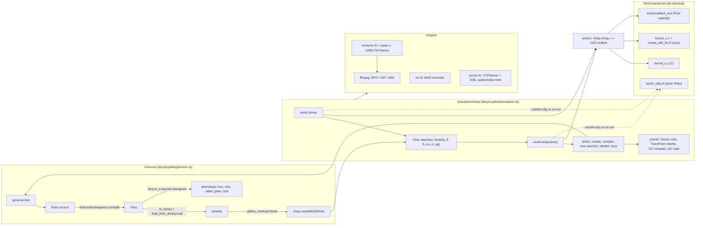

# Architecture

yarvpilled has a strict split. **YARV thinks, the world kernel moves.** Every decision a
creature makes comes from CRuby executing that creature's genome, a real
`RubyVM::InstructionSequence`. The world loop (C, Rust, asm or pure Ruby) handles physics and
bookkeeping only.



## One tick

1. **sense**: the world kernel builds a 6-value sensor vector per creature: food ahead, left
   and right (`fa fl fr`), energy (`en`), crowding from a spatial-hash neighbour scan (`cr`),
   and age (`ag`).
2. **think**: one `Fiber` per species calls that species' live `think` method for each of its
   creatures, yielding every 8 creatures to a round-robin scheduler. The returned Integer passes
   through a Refinement (`Integer#to_action`, `& 3`) that is lexically scoped to `simulation.rb`.
   Under the drift control, the brain still runs but its output is replaced by a random action.
3. **act**: the world kernel applies the actions. 0 graze (slow, big bite), 1 turn left and
   move, 2 turn right and move, 3 dash (extra cost). It also handles resource regrowth,
   eating, metabolism (`3 + cost + dash`), collisions, death (a corpse leaves food) and birth
   thresholds.
4. **births and deaths**: a parent splits its energy. With probability 0.3 the genome mutates
   (point, subtree, insert/delete, operator swap) and is recompiled into a new species
   (`Class.new(Mind)`).
5. **events** (off in benchmarks and the control): Ractor expert votes (every 40 ticks), a
   TracePoint gene transfer armed at tick 90 mod 150, `GC.compact` at 150 mod 300, and
   `GC.start` "amnesia" at 400 mod 420.

## World backends

| backend | file | notes |
|---|---|---|
| `ruby` | `lib/yarvpilled/world_ruby.rb` | Reference semantics in plain Ruby, used whenever the extension isn't built. |
| `c` / `native` | `ext/yarvpilled_native/kernel_c.c` | C99 on plain buffers, no Ruby objects. |
| `asm` | `kernel_c.c` + `crowd_x86_64.S` | Hand-written x86-64 SysV crowd scan (scalar SSE2, cmov grid wrap). Only on x86-64 Linux/BSD; elsewhere `:asm` uses the C scan. |
| `rust` | `ext/yarvpilled_rust/src/lib.rs` | The whole sense/act kernel. `#[repr(C)]` mirror of `World` in `world.h`, linked as a staticlib. |

`world.c` is the only file that touches Ruby objects on the native side. It converts Arrays to
and from `int32` buffers the same way for every native backend, so benchmark differences come
from the kernels alone. All backends keep the same IEEE-754 operation order (no FMA:
`-ffp-contract=off`; shared cos/sin tables), and `test/test_world_equivalence.rb` checks that
they stay bit-identical over 300 ticks with births.

## Fallbacks

- If `rake compile` fails, or there's no compiler, `Yarvpilled::Native::AVAILABLE` is false, and the
  world (`WorldRuby`) and rasterizer (`RasterRuby`) run in pure Ruby. Output is the same, just
  slower.
- `YARVPILLED_PURE=1` forces that path even when the extension is built.
- `:rust` raises `NotImplementedError` if the extension was built without cargo.
  `World.available?(kind)` reports what's usable, and `ruby yarv_brain.rb --version` lists it.

## Files

```
yarv_brain.rb            CLI: --video / --tui / --headless / --bench / --control / --version
server.rb                stdlib TCPServer + SSE; public/index.html canvas renderer
lib/yarvpilled/
  genome.rb              genome tree -> source -> ISeq -> to_binary -> brain; mutation; traits
  simulation.rb          tick loop, Fiber attention, births/deaths, TracePoint, Ractors, GC events
  guardrails.rb          Refinement guardrail, Instinct (prepend), Mind base class
  experts.rb             Ractor expert pool
  world.rb               backend selection + extension loading/fallback
  world_ruby.rb          pure-Ruby world
  control.rb             selection vs drift experiment and statistics
  bench.rb               multi-tier benchmark
  renderer.rb, gfx.rb    frame renderer, Canvas, PNG encoder, glyph atlas
  raster_ruby.rb         pure-Ruby rasterizer
  telemetry.rb, tui.rb, video.rb
ext/yarvpilled_native/   native.c, world.c, world.h, kernel_c.c, crowd_x86_64.S, raster.c, extconf.rb
ext/yarvpilled_rust/     Cargo.toml, src/lib.rs
test/                    minitest suite
tools/                   font atlas generator, TUI screenshot renderer
docs/                    this file, ADRs, FAQ, benchmark + control reports, media
```
